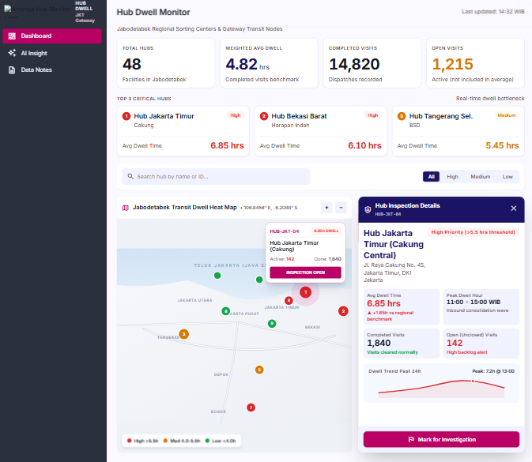
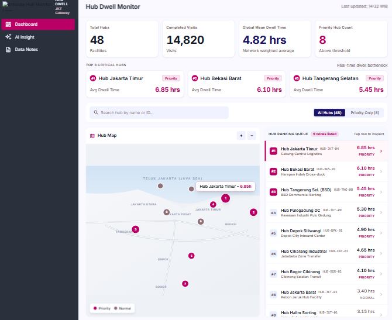
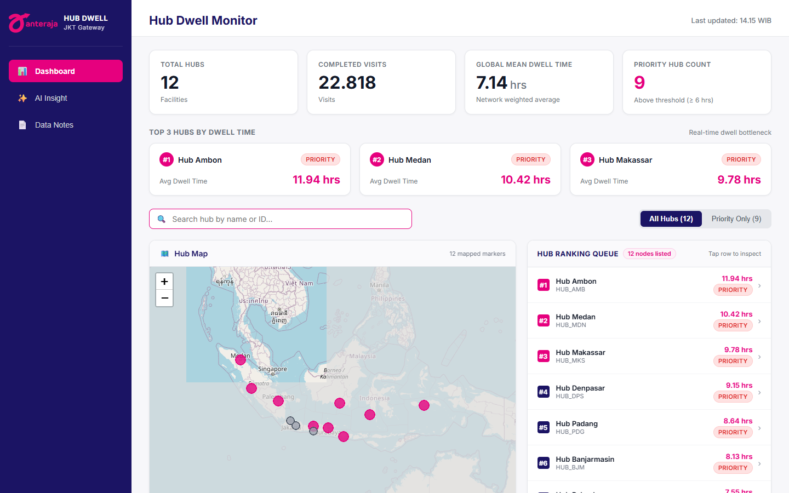
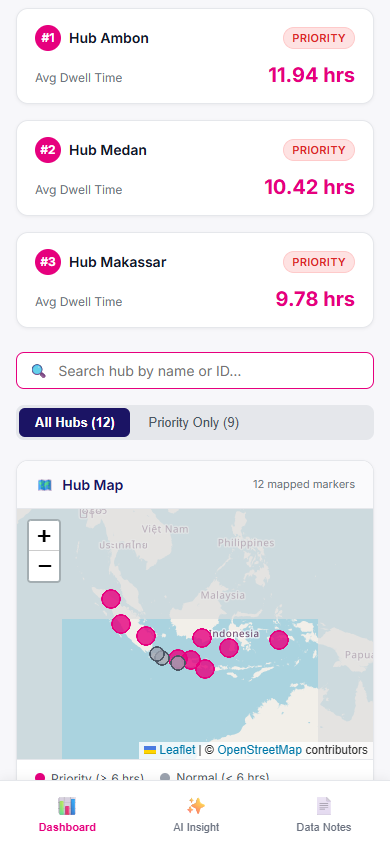

# Hub Dwell Monitor — Operational Dashboard Documentation

Operational dashboard built for Anteraja logistics hub supervisors to monitor dwell times, identify bottleneck facilities, and coordinate operational investigations across Indonesian gateway hubs.

---

## 1. Project Overview

The **Hub Dwell Monitor** is a responsive React application developed for operations supervisors managing logistics transit hubs across Indonesia. Dwell time—defined as the elapsed duration between package arrival scan and departure scan at a hub facility—is a critical key performance indicator (KPI) measuring throughput velocity and identifying warehouse sorting bottlenecks.

The application adheres to a minimal, high-efficiency supervisor workflow:
$$\text{Network KPIs} \longrightarrow \text{Top 3 Bottlenecks} \longrightarrow \text{Hub Ranking Queue} \longrightarrow \text{Priority Filtering} \longrightarrow \text{Leaflet Geographic Map} \longrightarrow \text{Hub Inspection Detail}$$

### Key Technical Architecture
- **Framework & Runtime**: React 19 (`react`, `react-dom`) initialized with Vite 8.
- **Mapping Engine**: Leaflet 1.9.4 with `react-leaflet` 5.0.0 using OpenStreetMap tile services and SVG CircleMarkers.
- **Styling**: Vanilla CSS utilizing custom properties (CSS variables), responsive grid and flex layouts, and zero heavy UI framework overhead.
- **State Management & Routing**: Lightweight component state (`useState`, `useMemo`) for instant single-page navigation across Dashboard, AI Insight, and Data Notes.
- **Test Automation**: Vitest unit test suite covering pure calculation routines and Playwright headless browser automation for responsive validation (1440px desktop & 390px mobile).

---

## 2. Data Sources

All application data is served statically from `public/data/` and loaded dynamically via the custom `useHubData` hook:

### 1. `public/data/metrics.json`
- **Source**: Aggregate metrics derived from 51,151 raw scan events (Day 18 dataset).
- **Quality & Volume**:
  - Raw scan events: 51,151
  - Package-hub pairs: 24,927
  - Completed visits (valid arrival + departure pairs): 22,818
  - Open visits (active arrival without departure): 924
  - Excluded pairs (invalid timestamp, missing arrival, non-positive dwell): 2,109
- **Hub Records (12 facilities)**: Contains `hub_id`, `completed_visits`, `mean_dwell_hours`, `median_dwell_hours`, `min_dwell_hours`, `max_dwell_hours`, `p90_dwell_hours`, `sample_sufficient`, and `mean_rank`.

### 2. `public/data/locations.json`
- **Source**: Geographic coordinates (city centroid) for 12 Indonesian gateway hub locations.
- **Fields**: `hub_id`, `hub_name`, `city`, `province`, `island`, `lat`, `lng`.
- **Note**: Simulation coordinates for operational training exercise.

### 3. `public/data/ai-summary.json`
- **Source**: Rule-based operational intelligence summary with schema fields: `summary`, `priority_hubs` (array of hub IDs), `next_checks` (array of actionable checklist items), and `disclaimer`.

### Data Adapter & Validation Layer
To insulate application components from raw field schema naming variations, [`src/utils/adapter.js`](../src/utils/adapter.js) normalizes incoming records into a uniform internal shape:
```typescript
interface Hub {
  hubId: string;
  name: string;
  lat: number | null;
  lng: number | null;
  meanDwellHours: number;
  minDwellHours: number | null;
  maxDwellHours: number | null;
  completedVisits: number;
  openVisits: number | null;
  isPriority: boolean; // Computed: meanDwellHours >= 6.0
}
```
Validation in [`src/utils/validation.js`](../src/utils/validation.js) executes on data load, checking for duplicate hub IDs, coordinates validity, and mismatches between datasets. If a hub in `locations.json` is missing from `metrics.json`, it is omitted to ensure calculation integrity.

---

## 3. Stitch Design

The visual design is aligned with the approved Stitch operational design system, engineered for immediate operational scanning and minimal cognitive friction.

### Brand Tokens & Design System
- **Primary Brand Colors**:
  - Primary Magenta: `#E6007E` (High-priority badges, active marker highlights, primary actions)
  - Deep Gateway Navy: `#1B1464` (Sidebar, major headings, key ranking badges)
  - Surface Neutral: `#F7F7FA` (Application background)
  - Card Surfaces: `#FFFFFF` with `1px solid #E5E7EB` border and `12px` border radius
- **Typography**: Inter (Google Fonts) with system sans-serif fallback. Dwell units are explicitly rendered as `"hrs"` across all visual components.

<!-- TODO: Stitch Design Assets Integration -->
> **TODO: Stitch Wireframe & Mockup References**
> - **Stitch Screen ID**: `[TODO: Insert Stitch Screen ID from design workspace]`
> - **Stitch Prototype URL**: `[TODO: Insert link to Stitch interactive prototype]`
> - **Approved Design Screenshots**:
>   - `screenshots/stitch-v1.png` — *Initial Stitch desktop & mobile concept*
>   - `screenshots/stitch-v2.png` — *Revised simplified supervisor workflow*

#### Stitch Design Mockups

*Figure: Initial Stitch desktop and mobile operational concept (v1).*


*Figure: Revised and approved supervisor workflow layout (v2).*

---

## 4. AI Testing

The AI Operational Insight feature interprets verified metrics from `ai-summary.json` into structured, plain-text operational advisory cards. All AI content is rendered exclusively as plain React text nodes to prevent script execution or markup injection vulnerabilities.

<!-- TODO: AI Studio Prompt Evaluation Table -->
> **TODO: AI Studio Test Suite Execution**
> The table below outlines the 4 required prompt evaluation scenarios to be recorded from Google AI Studio. Fill in parameters and test outputs when executed against the production prompt:

| Test Case | Prompt Scenario / Input Mutation | Expected Output Behavior | Evaluated Result |
|---|---|---|---|
| **Test 1: Normal Data** | Standard production `metrics.json` (12 hubs, 22,818 visits) | Cohesive summary identifying top bottleneck hubs (&ge; 6.0 hrs) and recommended checks | `[TODO: Record AI Studio Test 1 Output]` |
| **Test 2: No Priority Hub** | Synthetic metrics where all hub means are forced below 6.0 hrs | Expresses that no hubs breach the threshold; advises routine maintenance | `[TODO: Record AI Studio Test 2 Output]` |
| **Test 3: Empty Hubs** | Empty dataset with 0 hubs and 0 completed visits | Explicitly states operational data is unavailable; omits hallucinated statistics | `[TODO: Record AI Studio Test 3 Output]` |
| **Test 4: Untrusted Hub Name** | Hub name injected with prompt injection markup | Displays raw string verbatim without executing or altering output formatting | `[TODO: Record AI Studio Test 4 Output]` |

---

## 5. Application Features

### 1. Navigation & Page Header
- **Desktop Sidebar**: Compact, clean navigation featuring the Anteraja Hub Monitor brand logo, Hub Dwell branding, and 3 primary destinations: *Dashboard*, *AI Insight*, and *Data Notes*.
- **Mobile Bottom Navigation**: 3 fixed bottom tabs (`height: 64px`) matching desktop destinations with icons.
- **Dynamic Header**: Displays active page title on the left and dynamic data timestamp (`Last updated: HH:mm WIB`) on the right when `generated_at` exists in the data.

### 2. Network KPI Cards (Dashboard)
Four top-level metrics computed from verified records:
1. **Total Hubs**: Count of registered facilities (`12`).
2. **Completed Visits**: Total verified visits with both arrival and departure scans (`22,818`).
3. **Global Mean Dwell Time**: Network weighted average (`7.14 hrs`).
4. **Priority Hub Count**: Number of hubs with mean dwell time &ge; 6.0 hours (`9`).

### 3. Top 3 Hubs by Dwell Time
Three cards spotlighting the network's highest dwell times ranked by raw numeric duration, independent of active list filters:
- **#1 HUB_AMB** (Hub Ambon): `11.94 hrs` (Priority)
- **#2 HUB_MDN** (Hub Medan): `10.42 hrs` (Priority)
- **#3 HUB_MKS** (Hub Makassar): `9.78 hrs` (Priority)

### 4. Shared Filter & Search Bar
- **Search Input**: Real-time filtering matching hub name or hub ID (case-insensitive, trimmed).
- **Segmented Control**: Toggle between `All Hubs (12)` and `Priority Only (9)`.
- **Single Derived State**: Both `HubList` and `HubMap` consume the identical `visibleHubs` array derived through `useMemo`.

### 5. Interactive Leaflet Map
- **Geographic Markers**: SVG CircleMarkers colored by priority (`#E6007E` for priority &ge; 6 hrs, `#4B5563` for normal < 6 hrs).
- **Responsive Sizing**: 480px height on desktop, 250px on mobile. Fits bounds dynamically to visible markers on mount and filter changes.
- **Interactive Popup**: Shows hub name, ID, dwell hours, status badge, and an *"Inspect Details &rarr;"* action button.
- **Attribution**: Permanent, visible `© OpenStreetMap contributors` attribution.

### 6. Hub Detail Inspection
- **Desktop**: Inline transition replacing the list in the right column with a `← Back to list` button, keeping the map visible side-by-side.
- **Mobile**: Sliding bottom sheet modal (`max-height: 80vh`) with touch handle, full metric grid, and clear `✕` dismiss button.
- **Metric Breakdown**: Avg Dwell (`hrs`), Completed Visits, Min Dwell, Max Dwell, and Open Visits (`N/A` per hub as tracked at network level). Includes interactive *"Mark for investigation"* toggle button.

### 7. AI Insight Page
- **Summary Card**: High-level synthesis of network dwell status.
- **Priority Hubs Card**: Real metric cards for all priority hubs with completed visit counts.
- **Next Checks Card**: Numbered operational action items.
- **Verification Note**: Standard *"Generated from verified metrics only."* disclaimer.

### 8. Data Notes Page
- Formal definitions for *Dwell Time*, *Completed Visits*, *Open Visits (excluded from the average)*, and *Global Mean Dwell Time (weighted by completed visits)*.
- Documents the 6-hour threshold as a practice simulation rule (not an official Anteraja SLA).
- Data Sources table listing `metrics.json`, `locations.json`, and `ai-summary.json`.

---

## 6. Testing

### 1. Vitest Pure Calculation Unit Tests
Automated unit tests in [`src/utils/calculations.test.js`](../src/utils/calculations.test.js) (11/11 passed):
- **Weighted Global Mean**: Proves weighted calculation (`2.8 hrs`) differs from unweighted mean-of-means (`6.0 hrs`).
- **Open Visits Exclusion**: Confirms visits without departure scans do not inflate completed counts or distort dwell averages.
- **Numeric Sorting**: Verifies sort order relies on raw numbers so `10.2 hrs` ranks before `9.5 hrs` (preventing lexicographical string sort errors).
- **Tie Breaking**: Deterministic ascending sort by `hubId` for identical dwell values.
- **Threshold Boundary**: Exactly `6.00 hrs` evaluates to Priority (`>= 6.0`), while `5.99 hrs` evaluates to Normal.
- **Empty & Null Safety**: Empty arrays safely return `0` or `"N/A"` without `NaN`, `undefined`, or exceptions.

### 2. Step 8 Responsive Layout Testing (Playwright Automation)
Automated cross-device responsive test suite executed at Desktop 1440px and Mobile 390px viewports:

| Step 8 Verification Item | Desktop (1440px) | Mobile (390px) | Test Result & Behavior |
|---|:---:|:---:|---|
| **Layout: Side-by-side vs Stacked** | **PASS** | **PASS** | Desktop: Map left (60%) and List right (40%) side-by-side (`map.y === list.y`). Mobile: Map stacks vertically above List (`map.y < list.y`). |
| **Map Visibility** | **PASS** | **PASS** | Desktop: Map is 480px tall. Mobile: Map is 250px tall, positioned cleanly above the queue. |
| **Marker Popup Usability** | **PASS** | **PASS** | Clicking CircleMarker opens Leaflet popup with hub name, dwell hours (`hrs`), priority status, and inspect action. |
| **Detail Panel Open / Close** | **PASS** | **PASS** | Desktop: Replaces list with `← Back to list` button. Mobile: Opens bottom sheet modal; dismisses cleanly on `✕` tap. |
| **Metric Units Readability** | **PASS** | **PASS** | Dwell durations explicitly format with `"hrs"`; zero unformatted floats, `NaN`, or `undefined`. |
| **Priority Filter & Live Search** | **PASS** | **PASS** | Toggling "Priority Only" filters list and map to 9 priority nodes; search for `"Medan"` isolates 1 hub; clearing restores all 12 hubs. |
| **© OpenStreetMap Attribution** | **PASS** | **PASS** | Attribution control remains fully visible and legible on all screen sizes. |
| **Console Errors / Re-initialization** | **PASS** | **PASS** | Zero console errors. Switching pages (Dashboard &harr; AI Insight &harr; Data Notes) produces zero `"map already initialized"` warnings. |

#### Visual Verification Screenshots

*Figure 1: Desktop 1440px view showing side-by-side map and list, KPI cards, and Top 3 facilities.*


*Figure 2: Mobile 390px viewport demonstrating stacked map, list queue, and bottom navigation.*

### 3. Application State & Error Isolation Suite
Automated state permutation test suite testing each data file independently:

| State Scenario | File Tested | Result | Verification Notes |
|---|---|:---:|---|
| **Loading State (Slow Network)** | Network latency | **PASS** | Renders 46 skeleton placeholders across cards, top 3, map, and list. Zero layout jump. |
| **Error: Metrics Missing (404)** | `metrics.json` | **PASS** | Displays centered `ErrorView` with `"Failed to load metrics.json"` and functional `🔄 Retry` button. |
| **Isolation: Locations Missing** | `locations.json` | **PASS** | Dashboard remains fully usable: KPIs, Top 3, and queue list load all 12 hubs; coordinates omitted safely without crashing map. |
| **Isolation: AI Summary Missing** | `ai-summary.json` | **PASS** | Dashboard and Data Notes remain 100% operational; error isolated exclusively to `AiInsight` page with retry action. |
| **Invalid JSON Syntax** | `metrics.json` | **PASS** | JSON parse exception caught in try/catch; shows descriptive error view with retry. |
| **Empty Data (0 Hubs)** | `metrics.json` (`hubs: []`) | **PASS** | Renders `EmptyDatasetView` (`"No Hub Data Available"`), KPIs display 0, global mean displays 0 (never `NaN`). |
| **No Priority Hubs** | `metrics.json` (all means < 6 hrs) | **PASS** | Selecting "Priority Only" displays `EmptyPriorityView` (`"No hubs meet the priority threshold"`) with `"Show All Hubs"` button. |
| **Filter Empty (Search Miss)** | Search query | **PASS** | Displays `EmptyView` (`"No hubs match your filter"`) with functional `"Reset filter"` button. |
| **AI Wrong Schema Shape** | `ai-summary.json` | **PASS** | Gracefully displays `"Data not available"` cards without crashing; verification disclaimer remains visible. |

---

## 7. Operational Insight

Based strictly on the aggregated metrics, **Hub Medan (`HUB_MDN`)** is the primary facility that should be investigated first. While Hub Ambon (`HUB_AMB`) records a higher raw mean dwell time of 11.94 hours, that figure represents only 48 completed visits (0.21% of network volume, flagged with `sample_sufficient: false`). In contrast, Hub Medan records a mean dwell time of **10.42 hours** (min: 4.12 hrs, max: 23.85 hrs, p90: 14.13 hrs) across **1,845 completed visits**, which constitutes 8.09% of all completed network visits (1,845 out of 22,818). Across the entire network, there are 924 active open visits currently awaiting departure, and Hub Medan's dwell time exceeds the 6.0-hour priority simulation threshold by 4.42 hours (73.7% above threshold), making it the single largest volume-backed dwell bottleneck in the operational dataset.

### Calculation Breakdown
- **Network Volume**: $\Sigma(\text{completed\_visits}) = 22,818$; $\text{open\_visits} = 924$.
- **Weighted Global Mean Dwell Time**:
  $$\frac{\sum (\text{mean\_dwell} \times \text{completed\_visits})}{\sum \text{completed\_visits}} = \frac{162,883.67}{22,818} = 7.1384\text{ hrs (rendered as 7.14 hrs)}$$
- **Hub Medan Volume Share**:
  $$\frac{1,845}{22,818} \times 100\% = 8.0857\% \approx 8.09\%$$
- **Hub Medan Threshold Breach**:
  $$10.4218\text{ hrs} - 6.00\text{ hrs} = +4.4218\text{ hrs} \ (+73.7\%)$$
